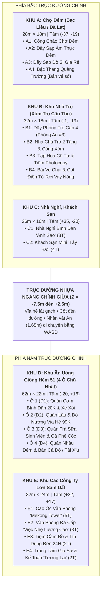

# Bản Đồ Quy Hoạch 3D Chương 1 — Game *"Xóm Trọ"* (`v0.2`)

> [!TIP]
> **Dự án Website 3D Giả Lập đã được khởi tạo và mở sẵn trên trình duyệt của bạn:**
> - **Thư mục dự án**: `C:\Users\littl\.gemini\antigravity\scratch\BanDoChuong1_Web3D`
> - **File chạy chính**: [index.html](file:///C:/Users/littl/.gemini/antigravity/scratch/BanDoChuong1_Web3D/index.html) (hoặc nhấp đúp vào [CHAY_WEB_3D.bat](file:///C:/Users/littl/.gemini/antigravity/scratch/BanDoChuong1_Web3D/CHAY_WEB_3D.bat))
> - **File dữ liệu quy hoạch & cốt truyện**: [map_data.js](file:///C:/Users/littl/.gemini/antigravity/scratch/BanDoChuong1_Web3D/map_data.js)
> - **Tài liệu gốc đã đối chiếu**: [game-concept-v0.2.md](file:///C:/Users/littl/Downloads/game-concept-v0.2.md)

---

## 1. Sơ Đồ Tổng Quan 5 Khu Vực & 16 Công Trình (Chuẩn Tỉ Lệ `1 đơn vị = 1 mét`)

---

## 2. Bảng Chi Tiết 16 Lô Xây Dựng Gắn Với Cốt Truyện Chương 1 (`game-concept-v0.2.md`)

| Mã Lô | Tên Công Trình | Khu Vực | Kích Thước (`Rộng × Sâu × Cao`) | Tọa Độ Tâm `(X, Z)` | Vai Trò Trong Chương 1 & Cửa Vào 4 Nhánh |
| :--- | :--- | :--- | :---: | :---: | :--- |
| **`A1`** | Cổng Chào Chợ Đêm & Chốt Bảo Vệ | Khu A (Chợ Đêm) | `8.0m × 2.2m × 5.2m` | `(-37.0, -11.2)` | Điểm bắt đầu ca **Bán vé số / hàng rong** buổi tối |
| **`A2`** | Dãy Sạp Ẩm Thực Đêm (Sữa đậu nành, Nướng) | Khu A (Chợ Đêm) | `11.0m × 5.0m × 3.3m` | `(-44.0, -18.5)` | Ăn tối giá rẻ hồi Tinh thần; gặp cô bán hàng tốt bụng (**Nhánh 1**) |
| **`A3`** | Dãy Sạp Đồ Si (Quần Áo Cũ 20K–35K) | Khu A (Chợ Đêm) | `11.0m × 5.0m × 3.3m` | `(-30.0, -18.5)` | Mua đồ giá rẻ hoặc **bán đồ đạc cá nhân** khi cần tiền gấp |
| **`A4`** | Bậc Thang Quảng Trường & Khu Bán Vé Số | Khu A (Chợ Đêm) | `18.0m × 4.2m × 2.2m` | `(-37.0, -24.8)` | Mini-game **Chọn tuyến bán vé số dạo** (gặp khách mua giúp hoặc kẻ bắt nạt) |
| **`B1`** | **Dãy Phòng Trọ Cấp 4 (Phòng của An #3)** | Khu B (Nhà Trọ) | `18.0m × 6.2m × 3.8m` | `(-5.5, -23.0)` | **Không gian chính**: Lưu game, cất **Tấm bằng Cử nhân trên nóc tủ gỉ sét**, nhận **Cuộc gọi từ quê nhà** |
| **`B2`** | Nhà Chủ Trọ (2 Tầng) & Cổng Xóm Trọ | Khu B (Nhà Trọ) | `6.8m × 6.5m × 7.2m` | `(8.5, -22.5)` | **Ngày mốc cuối tháng**: Đóng tiền phòng/điện nước, xin khất nợ để không bị đuổi |
| **`B3`** | Tiệm Tạp Hóa Cô Tư & Tiệm Photocopy | Khu B (Nhà Trọ) | `13.0m × 5.5m × 4.5m` | `(-7.0, -13.2)` | Việc làm **Phụ tiệm tạp hóa**; trung tâm tin tức xóm; **Cửa vào Nhánh 2 (Ghi số đề)** |
| **`B4`** | Góc Thu Mua Ve Chai & Cột Điện Tờ Rơi | Khu B (Nhà Trọ) | `7.5m × 5.0m × 3.4m` | `(7.0, -13.0)` | Việc làm **Nhặt ve chai** khi cạn tiền; **Cửa vào Nhánh 3 (Tờ rơi Vay Nóng)** |
| **`C1`** | Nhà Nghỉ Bình Dân *"Ánh Sao"* (3 Tầng) | Khu C (Nhà Nghỉ) | `9.5m × 8.5m × 10.8m` | `(29.0, -20.0)` | Giao đồ ăn đêm; nơi xuất hiện gián tiếp các đối tượng xấu (**Nhánh 2 & 3**) |
| **`C2`** | Khách Sạn Mini *"Tây Đô"* (4 Tầng) | Khu C (Nhà Nghỉ) | `11.0m × 9.0m × 14.2m` | `(41.0, -20.0)` | Việc làm thêm **Tạp vụ dọn phòng theo ca** (thu nhập theo ngày, tốn Sức khỏe) |
| **`D1`** | **Ô 1**: Quán Cơm Bình Dân 20K & Xe Xôi | Khu D (Hẻm 51) | `12.0m × 7.5m × 4.2m` | `(-43.0, +15.5)` | Việc làm **Phụ rửa chén**; gặp chủ quán tốt bụng cho cơm mang về (**Nhánh 1**) |
| **`D2`** | **Ô 2**: Quán Lẩu & Đồ Nướng Vỉa Hè Hẻm 51 | Khu D (Hẻm 51) | `13.0m × 7.5m × 4.5m` | `(-28.0, +15.5)` | Việc làm **Bưng bê ca tối** (mệt, bị chủ mắng, chạnh lòng vì bằng đại học) |
| **`D3`** | **Ô 3**: Quán Trà Sữa Sinh Viên & Cà Phê Cóc | Khu D (Hẻm 51) | `12.0m × 7.0m × 4.3m` | `(-13.0, +15.5)` | Gặp bạn học cũ; nhận việc **Giao hàng vặt** hoặc bị rủ rê kèo **Nhánh 4** |
| **`D4`** | **Ô 4**: Quán Nhậu Đêm & Bàn Cá Độ / Tài Xỉu | Khu D (Hẻm 51) | `12.0m × 7.0m × 4.0m` | `(+2.0, +15.5)` | **Cửa vào Nhánh 2**: Bạn xóm rủ chơi **Tài xỉu / Cá độ bóng đá** gỡ gạc |
| **`E1`** | Tòa Nhà Văn Phòng *"Mekong Tower"* (5 Tầng) | Khu E (Công Ty) | `13.0m × 10.0m × 18.5m` | `(+24.5, +12.5)` | Nơi An nộp hồ sơ xin việc đầu Chương 1 nhưng bị từ chối vì thiếu kinh nghiệm |
| **`E2`** | Văn Phòng *"Việc Nhẹ Lương Cao / Đầu Tư 4.0"* | Khu E (Công Ty) | `11.5m × 9.0m × 11.5m` | `(+39.5, +12.5)` | **Cửa vào Nhánh 4**: Lừa đảo online, đa cấp, đóng tiền cọc làm nhiệm vụ |
| **`E3`** | Tiệm Cầm Đồ & Tài Chính Nhanh *"24H"* | Khu E (Công Ty) | `11.5m × 7.5m × 8.2m` | `(+24.5, +24.0)` | **Cửa vào Nhánh 3**: Bán đồ đạc cầm cố, ký giấy **Vay nặng lãi / App tín dụng đen** |
| **`E4`** | Trung Tâm Gia Sư & Kế Toán *"Tương Lai"* | Khu E (Công Ty) | `11.5m × 7.5m × 8.5m` | `(+39.5, +24.0)` | **Đích đến Nhánh 1 (Tự lập)**: Mở khóa việc **Gia sư / Phụ sổ sách** nhờ tấm bằng Cử nhân |

---

## 3. Cách Dùng Website 3D Để Giao Việc Cho AI Vẽ Blender

1. **Click vào bất kỳ tòa nhà nào** trên bản đồ 3D (hoặc chọn ở cột bên trái) để xem:
   - Tòa nhà đó xây cái gì, cao bao nhiêu mét so với nhân vật **An (`1.65 m`)**, gồm những vật dụng (Props) nào.
   - Vai trò của tòa nhà đó trong mạch truyện Chương 1 (`game-concept-v0.2.md`).
2. **Tuỳ chỉnh trực tiếp nếu muốn**:
   - Bạn có thể sửa lại `Tọa độ X, Z`, `Chiều Rộng, Sâu, Cao`, `Tên biển hiệu` ở cột phải hoặc bấm nút **`➕ Thêm Nhà Mới`** trên thanh công cụ để đặt thêm công trình mới vào bản đồ.
3. **Copy Prompt giao AI vẽ Blender**:
   - Ở góc dưới bên phải có hộp **"🤖 Prompt giao AI vẽ Blender"**: nội dung prompt tự động cập nhật theo đúng kích thước và chi tiết của ngôi nhà bạn đang chọn. Bạn chỉ cần nhấn nút **`📋 Copy Prompt`** rồi gửi cho AI là có ngay mô hình Blender chuẩn tỉ lệ!
